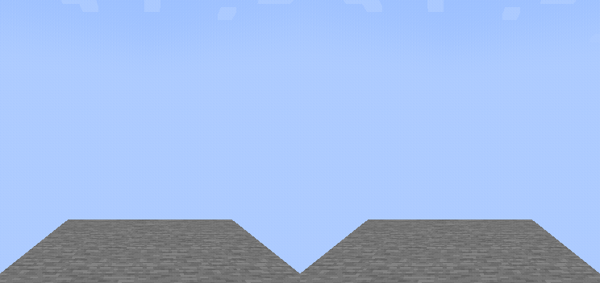

# 近地飞行物理选型

**决定采用方案 A，近地飞行使用 Sable。** 星球上的 Create 升降台需要能托起飞船。Sable 让同一维度里的飞船刚体和地面移动机构使用同一个碰撞求解器。下面的两项实验分别验证盒子落地和移动平台承载。整船的质量、质心、转动惯量与受力将在 #10 接入。[设计议题 #3](https://github.com/jxt159753/BlockSpaceProgram/issues/3) · [飞船实体与飞行物理 #10](https://github.com/jxt159753/BlockSpaceProgram/issues/10)

## 与机械动力升降台的碰撞

在独立的 Minecraft 1.21.1 专用服务器上，Create 6.0.10 的机械活塞推动一块石台，台面上自由放置一个 Sable 2.0.6 的铜块刚体（`ServerSubLevel`）。铜块通过接触随平台上升。活塞伸出 4.250 格时，铜块已升高 4.195 格。活塞走完 8 格后，铜块质心从 Y=81.4972 升至 Y=89.4972 并静止。[实测数据与复测命令](create-platform.md)

地面机构由 Create 指定运动，Sable 将它的碰撞体加入 Rapier。这个接触过程足以实现平台举升。若要让重船增加驱动轴的应力消耗（SU），还需将船的负载接入 Create 的动力网络。舱内旋转机构与多零件整船尚待验证。[Sable 的 Create 接入][create-compat] · [Rapier 运动学刚体][contraptions] · [Create 应力计算][stress]

## 落地表现

两种原型都让一个边长 1 格、质量 1 kg 的盒子从石台正上方 32 格静止释放。重力为 11 m/s²，无空气阻力，每游戏刻计算两个物理子步。A 用 Sable 的 Rapier 刚体，B 对竖直速度做半隐式欧拉积分，用 Minecraft 的方块碰撞形状裁剪盒子的扫掠位移。水平放置、正面着地的盒子没有外加力矩。[两个原型](java/io/github/jxt159753/blockspaceprogram/experiment/DropBox.java)

| 2026-11-25，正式测量各 12 次 | Sable | 自写单刚体 |
| --- | ---: | ---: |
| 首次接触 | 第 49 tick（2.45 s） | 第 48 tick（2.40 s） |
| 质心低于理想贴地位置的最大距离 | 0.2274 格 | 0 格 |
| 接触后从最低点回升的最大距离 | 0.2246 格 | 0 格 |
| 第 100 tick 的质心相对贴地高度 | −0.0028 格 | 0 格 |
| 最后 20 tick 的质心高度极差 | 0 格 | 0 格 |

以质心距台面 0.5 格为理想贴地位置，第一次降到其上方 0.02 格以内计为接触。12 次均得到表中相同的落地轨迹指标。自写方案在第一次接触时停稳。Sable 有短暂的下沉和回正，最终也能停稳。

同一机位的客户端落地回放，左侧为 Sable，右侧为自写方案。画面以半速播放，表中数据取自服务端物理位置。



## 服务器耗时

Windows 11，Intel Core Ultra 9 275HX，Microsoft OpenJDK 21.0.11，Minecraft 1.21.1，NeoForge 21.1.267。测试在同一个无玩家的专用服务器进程中完成，视距与模拟距离均为 4。三个场景均加载 Sable 2.0.6 和 spark 1.10.124，空场景只有石台。每格为该轮最后 10 秒的整服 **P50 / P95 MSPT**，单位为毫秒。[spark 指标定义](https://spark.lucko.me/docs/guides/TPS-and-MSPT)

| 轮次及执行顺序 | 空场景 | Sable | 自写单刚体 |
| --- | ---: | ---: | ---: |
| 1 · 空、Sable、自写 | 0.4824 / 0.8136 | 0.6204 / 0.9589 | 0.4631 / 0.7013 |
| 2 · 自写、空、Sable | 0.3731 / 0.6637 | 0.5068 / 0.8482 | 0.4178 / 0.8294 |
| 3 · Sable、自写、空 | 0.3087 / 0.6791 | 0.4646 / 0.7822 | 0.3316 / 0.6695 |

三轮 P95 的中位数为空场景 0.6791 ms、Sable 0.8482 ms、自写 0.7013 ms。自写原型在平地立即停稳、耗时较低。这组数据只覆盖静态石台上的单盒落地。要支持星球基地的升降台，自写方案还需接入 Create 的移动碰撞体。倾斜撞击、着陆腿多点支撑和多船负载仍需用整船验证。[飞船物理 #10](https://github.com/jxt159753/BlockSpaceProgram/issues/10) · [性能基准 #22](https://github.com/jxt159753/BlockSpaceProgram/issues/22)

## Sable 2.0.6 的接口与约束

- **简化碰撞体。** `BoxPhysicsObject` 接受位姿、半尺寸和质量，本次已通过 `SubLevelPhysicsSystem.addObject` 验证了独立盒子与地形碰撞。子层级另有按方块状态提供 `VoxelShape` 的接口，Rapier 烘焙时会将各子盒裁在该方块的单位立方体内。在此版本的公开接口中未找到把任意多个零件盒挂到同一刚体的入口。给多个独立盒子加固定约束则需要解算多个刚体。[独立盒子][box] · [方块形状烘焙][bake] · [刚体与约束接口][pipeline]
- **施力。** `RigidBodyHandle.of(level, body)` 能取得刚体句柄，`applyImpulseAtPoint` 支持在局部指定点施加冲量，`applyLinearAndAngularImpulse` 支持线冲量和角冲量。持续推力可按物理子步将力乘以步长后施加。上游浮力实现也使用子步时长。[刚体句柄][handle] · [上游施力用法][forces]
- **跨维度。** 每个 `ServerLevel` 拥有独立的物理系统。`teleport` 操作当前物理场景中的刚体。轨道交接由本模组保存飞船的位置、姿态、线速度与角速度，离开近地段时释放刚体，在目标维度重新创建并恢复状态。[维度物理系统][system] · [Rapier 实现][rapier]
- **版本与许可证。** 调研源码与实测发行包均对应 Sable 标签 `mc1.21.1-2.0.6-neoforge`。2.0.0 的发布说明记录过约束 API 变动，升级需要回归验证。Sable 使用 PolyForm Shield 1.0.0，包含竞争用途限制以及再分发时的许可证和通知要求。实验单独安装作者发布的 JAR。本项目使用 MIT，当前工程骨架运行依赖为 Minecraft 和 NeoForge，正式飞船模块接入时再声明 Sable 依赖。[2.0.0 变更](https://modrinth.com/mod/sable/version/2.0.0%2Bmc1.21.1) · [许可证][license]

## 复测落体实验

1. 将两个官方 JAR 放入 `runs/physicsDrop/mods/`，保留原文件名。实验源码仅通过 `-PphysicsDrop` 加载。[Sable 2.0.6](https://modrinth.com/mod/sable/version/fg9dTRz9) · [spark 1.10.124](https://modrinth.com/mod/spark/version/v5qtqRQi)
2. 首次启动前，在 `runs/physicsDrop/server.properties` 填入以下配置。执行 `./gradlew -PphysicsDrop runPhysicsDrop --console=plain`，Windows 使用 `.\gradlew.bat`。

```properties
server-ip=127.0.0.1
server-port=25576
level-type=minecraft:flat
level-seed=3
generate-structures=false
difficulty=peaceful
spawn-monsters=false
spawn-animals=false
spawn-npcs=false
view-distance=4
simulation-distance=4
```

3. 在这份独立测试存档的服务器控制台执行以下命令。石台顶面在 Y=80，盒子底面从 Y=112 释放。

```mcfunction
forceload add 8 8
gamerule doMobSpawning false
gamerule randomTickSpeed 0
gamerule doWeatherCycle false
fill 6 79 6 10 79 10 minecraft:stone
```

4. 执行 `execute positioned 8 80 8 run bspdrop sable`。看到 `DROP spark` 后把末尾换成 `single`，分别预热两个后端。随后按上表顺序运行 `idle`、`sable` 或 `single`。每个场景持续 400 tick，活动场景每 100 tick 重新落一次。`runs/physicsDrop/logs/latest.log` 中的 `DROP landing` 记录接触与回升，`DROP spark` 记录 spark API 的 10 秒窗口均值、P50 和 P95。
5. 观察画面时，让玩家在试验开始前进入主世界并站在石台旁，再单独重跑两种方案。铜块显示实体跟随盒子质心。性能采样时保持零玩家。结束后在控制台执行 `stop`。

[box]: https://github.com/ryanhcode/sable/blob/ad8b4d377741fbd923f4d863b2cf9e462daff9a6/common/src/main/java/dev/ryanhcode/sable/api/physics/object/box/BoxPhysicsObject.java
[bake]: https://github.com/ryanhcode/sable/blob/ad8b4d377741fbd923f4d863b2cf9e462daff9a6/sable_rapier/src/main/java/dev/ryanhcode/sable/physics/impl/rapier/collider/RapierVoxelColliderBakery.java
[pipeline]: https://github.com/ryanhcode/sable/blob/ad8b4d377741fbd923f4d863b2cf9e462daff9a6/common/src/main/java/dev/ryanhcode/sable/api/physics/PhysicsPipeline.java
[handle]: https://github.com/ryanhcode/sable/blob/ad8b4d377741fbd923f4d863b2cf9e462daff9a6/common/src/main/java/dev/ryanhcode/sable/api/physics/handle/RigidBodyHandle.java
[forces]: https://github.com/ryanhcode/sable/blob/ad8b4d377741fbd923f4d863b2cf9e462daff9a6/common/src/main/java/dev/ryanhcode/sable/physics/floating_block/FloatingBlockController.java
[system]: https://github.com/ryanhcode/sable/blob/ad8b4d377741fbd923f4d863b2cf9e462daff9a6/common/src/main/java/dev/ryanhcode/sable/sublevel/system/SubLevelPhysicsSystem.java
[rapier]: https://github.com/ryanhcode/sable/blob/ad8b4d377741fbd923f4d863b2cf9e462daff9a6/sable_rapier/src/main/java/dev/ryanhcode/sable/physics/impl/rapier/RapierPhysicsPipeline.java
[license]: https://github.com/ryanhcode/sable/blob/ad8b4d377741fbd923f4d863b2cf9e462daff9a6/LICENSE.md
[create-compat]: https://github.com/ryanhcode/sable/blob/ad8b4d377741fbd923f4d863b2cf9e462daff9a6/neoforge/src/main/java/dev/ryanhcode/sable/neoforge/mixin/compatibility/create/contraptions/AbstractContraptionEntityMixin.java#L97
[contraptions]: https://github.com/ryanhcode/sable/blob/ad8b4d377741fbd923f4d863b2cf9e462daff9a6/sable_rapier/src/main/rust/rapier/src/contraptions.rs#L62
[stress]: https://github.com/Creators-of-Create/Create/blob/ac0c444d9828da3453ae8cc65338e8de063286fb/src/main/java/com/simibubi/create/content/kinetics/KineticNetwork.java#L149
